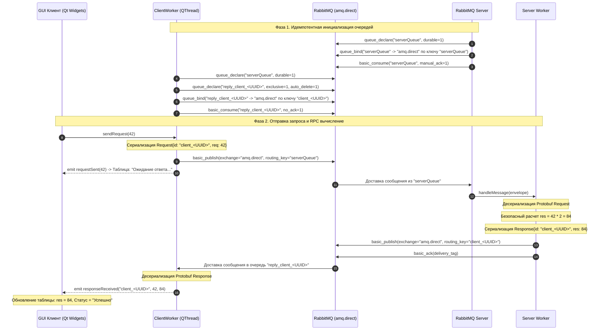

# RabbitMQ Qt Client-Server: Полная пояснительная записка и архитектурное руководство

[](https://en.wikipedia.org/wiki/C%2B%2B)
[](https://cmake.org/)
[](https://www.qt.io/)
[](https://www.rabbitmq.com/)
[](https://developers.google.com/protocol-buffers)
[](https://github.com/google/googletest)
[]()

> **Пояснительная записка к проекту**  
> Настоящий документ представляет собой исчерпывающее техническое руководство и пояснительную записку к проекту клиент-серверного взаимодействия на базе брокера сообщений **RabbitMQ**, библиотеки **librabbitmq-c**, контракта сериализации **Google Protocol Buffers**, графического интерфейса **Qt5 Widgets** и автоматизированного тестового комплекса **Google Test**.
> 
> Руководство создано для детального понимания принципов работы проекта, внутреннего устройства каждого класса, назначения каждого метода и механизмов асинхронного сетевого взаимодействия.

---

## 📑 Содержание

1. [Простыми словами: Что делает этот проект?](#1-простыми-словами-что-делает-этот-проект)
2. [Основы RabbitMQ и протокола AMQP 0-9-1](#2-основы-rabbitmq-и-протокола-amqp-0-9-1)
3. [Архитектура проекта и шаблон RPC (Remote Procedure Call)](#3-архитектура-проекта-и-шаблон-rpc-remote-procedure-call)
4. [Диаграмма последовательности (Sequence Diagram)](#4-диаграмма-последовательности-sequence-diagram)
5. [Сетевой протокол данных (Google Protocol Buffers)](#5-сетевой-протокол-данных-google-protocol-buffers)
6. [Структура каталогов и файлов проекта](#6-структура-каталогов-и-файлов-проекта)
7. [Подробный разбор каждого класса и каждого метода](#7-подробный-разбор-каждого-класса-и-каждого-метода)
   - [7.1. Общий модуль `src/common`](#71-общий-модуль-srccommon)
     - [Класс `Config` (Управление настройками)](#класс-config-управление-настройками)
     - [Класс `Logger` (Потокобезопасное логирование)](#класс-logger-потокобезопасное-логирование)
   - [7.2. Серверный модуль `src/server`](#72-серверный-модуль-srcserver)
     - [Файл `main.cpp` (Точка входа и обработка сигналов ОС)](#файл-maincpp-точка-входа-и-обработка-сигналов-ос)
     - [Класс `Server` (Сетевое AMQP ядро сервера)](#класс-server-сетевое-amqp-ядро-сервера)
     - [Класс `Worker` (Бизнес-логика и обработка сообщений)](#класс-worker-бизнес-логика-и-обработка-сообщений)
   - [7.3. Клиентский модуль `src/client`](#73-клиентский-модуль-srcclient)
     - [Файл `main.cpp` (Инициализация приложения Qt)](#файл-maincpp-инициализация-приложения-qt)
     - [Класс `ClientWorker` (Фоновый сетевой поток клиента)](#класс-clientworker-фоновый-сетевой-поток-клиента)
     - [Класс `MainWindow` (Главное окно GUI на Qt Widgets)](#класс-mainwindow-главное-окно-gui-на-qt-widgets)
     - [Класс `SettingsDialog` (Диалог горячей смены настроек)](#класс-settingsdialog-диалог-горячей-смены-настроек)
8. [Комплекс модульного тестирования (Google Test)](#8-комплекс-модульного-тестирования-google-test)
9. [Конфигурационные файлы (.ini)](#9-конфигурационные-файлы-ini)
10. [Сборка, запуск и проверка работоспособности](#10-сборка-запуск-и-проверка-работоспособности)
11. [Вопросы и ответы (FAQ)](#11-вопросы-и-ответы-faq)

---

## 1. Простыми словами: Что делает этот проект?

Представьте распределенную систему:
- У вас есть **сервер** (консольная служба), умеющая быстро и надежно выполнять вычисления (в рамках задачи — удваивать число $N \to 2N$ с защитой от переполнения памяти).
- У вас есть **один или несколько клиентов** с графическим интерфейсом (GUI на Qt), где пользователи вводят числа, нажимают «Отправить запрос» и видят результаты в таблице.
- Клиенты и сервер **не общаются напрямую по TCP-сокетам** и ничего не знают об IP-адресах друг друга. Вместо этого они общаются через надежного посредника — **брокер сообщений RabbitMQ**.

### Почему именно брокер сообщений, а не прямой HTTP/TCP?
1. **Независимость запуска**: Вы можете включить клиент, отправить 10 запросов, когда сервер даже не запущен. Сообщения не потеряются: RabbitMQ сохранит их на диске в очереди. Когда сервер запустится, он сразу прочитает их и обработает.
2. **Масштабируемость**: Если запросов станет миллион, вы можете запустить 5 одинаковых экземпляров сервера параллельно. RabbitMQ сам распределит запросы между ними по алгоритму балансировки.
3. **Изоляция сбоев**: Если сервер внезапно упадет во время обработки, брокер вернет необработанное сообщение обратно в очередь, и его подхватит другой воркер.

---

## 2. Основы RabbitMQ и протокола AMQP 0-9-1

RabbitMQ работает по стандарту **AMQP 0-9-1** (Advanced Message Queuing Protocol). Чтобы понимать код проекта, важно знать базовые сущности:

| Термин AMQP | Что это такое простыми словами | Как используется в проекте |
| :--- | :--- | :--- |
| **Broker (Брокер)** | Сам сервер RabbitMQ, который принимает, хранит и пересылает сообщения. | Запущен на `localhost:5672`. |
| **Connection (Соединение)** | Реальное сетевое TCP-соединение между приложением и брокером. | Создается через `amqp_new_connection()` и сокет `amqp_tcp_socket_new()`. |
| **Channel (Канал)** | Легковесный виртуальный поток внутри одного TCP-соединения. Все команды AMQP выполняются в канале. | Канал №1 (`amqp_channel_t m_channel = 1`). |
| **Exchange (Обменник)** | «Почтовое отделение». Сюда отправитель публикует сообщение. Exchange решает, в какие очереди его положить. | Стандартный прямой обменник `amq.direct`. |
| **Queue (Очередь)** | Буфер в памяти или на диске, где хранятся сообщения до тех пор, пока их не заберет получатель. | `serverQueue` (для запросов к серверу) и `reply_<UUID>` (персональная очередь каждого клиента). |
| **Routing Key (Ключ маршрутизации)** | «Адрес на конверте». Строка, по которой обменник определяет целевую очередь. | Для запросов: `serverQueue`. Для ответов: персональный `client_id` клиента. |
| **Binding (Привязка)** | Правило связи между Exchange и Очередью: «пересылай в очередь $Q$ все сообщения с ключом $K$». | Очередь сервера привязана с ключом `serverQueue`, очередь клиента — с ключом `client_id`. |
| **Ack (Подтверждение)** | Сигнал брокеру от получателя: «Я успешно обработал сообщение, можешь удалить его из очереди». | Ручной ACK (`amqp_basic_ack`) на сервере для надежности. |

---

## 3. Архитектура проекта и шаблон RPC (Remote Procedure Call)

В проекте реализован классический шаблон **RPC поверх RabbitMQ**.

### Проблема: как вернуть ответ конкретному клиенту, если клиентов много?
Если 10 клиентов одновременно отправят запросы в одну очередь сервера `serverQueue`, как сервер поймет, кому именно отправить удвоенное число?

### Архитектурное решение в проекте:
1. **Генерация `client_id`**: При старте каждый клиент генерирует глобально уникальный идентификатор на базе UUID (например, `client_c75d622c-a16e-433f-a76d-8eac556fd9d9`).
2. **Персональная очередь ответов**: Клиент объявляет временную эксклюзивную очередь `reply_<client_id>` и привязывает её к обменнику `amq.direct` с ключом маршрутизации `routing_key = client_id`.
3. **Отправка запроса**: Клиент упаковывает запрос:
   - В поле `id` кладет свой `client_id`;
   - В поле `req` кладет введенное число $N$;
   - Публикует сообщение в `amq.direct` с ключом `serverQueue`.
4. **Обработка сервером**:
   - Сервер забирает сообщение из `serverQueue`;
   - Достает `id` клиента и число $N$;
   - Рассчитывает удвоенное значение $res = 2 \times N$;
   - Упаковывает ответ `Response(id, res)`;
   - Публикует ответ в `amq.direct` с ключом маршрутизации, равным `id` клиента!
   - Отправляет брокеру подтверждение `ACK`.
5. **Получение клиентом**:
   - Обменник направляет ответ строго в персональную очередь этого клиента;
   - Другие клиенты этот ответ физически не видят (полная изоляция потоков ответов);
   - Клиент считывает ответ и отображает его в таблице GUI.

---

## 4. Диаграмма последовательности (Sequence Diagram)

Ниже представлена пошаговая визуализация работы системы от момента старта до отображения результата в интерфейсе:



---

## 5. Сетевой протокол данных (Google Protocol Buffers)

Для передачи данных по сети выбран **Google Protocol Buffers (proto2)** — бинарный, компактный и строго типизированный формат сериализации.

Контракт описан в файле `src/common/Messages.proto`:

```protobuf
syntax = "proto2";

package TestTask.Messages;

// Запрос от клиента к серверу
message Request {
    required string id = 1; // Уникальный идентификатор клиента (UUID)
    required int32 req = 2; // Целое 32-битное число, которое требуется удвоить
}

// Ответ от сервера клиенту
message Response {
    required string id = 1; // Идентификатор клиента, запросившего операцию
    required int32 res = 2; // Результат удвоения (req * 2)
}
```

### Почему именно Proto2 и поля `required`?
- В стандарте `proto2` наличие модификатора `required` гарантирует, что если клиент или сервер случайно сформирует сообщение без ID или без числа, метод `IsInitialized()` вернет `false`, а `SerializeToString()` завершится с ошибкой.
- Это предотвращает появление в очереди поврежденных или неполных пакетов.

---

## 6. Структура каталогов и файлов проекта

```text
rabbitmq-qt-client-server/
├── CMakeLists.txt              # Главный сборочный файл проекта
├── README.md                   # Настоящая пояснительная записка и документация
├── configs/                    # Конфигурационные INI-файлы по умолчанию
│   ├── client.ini              # Настройки брокера и логов для клиента
│   └── server.ini              # Настройки брокера и логов для сервера
├── src/                        # Исходный код системы
│   ├── common/                 # Библиотека common (разделяемая между всеми)
│   │   ├── CMakeLists.txt      # Сборка libcommon.a и автогенерация Protobuf
│   │   ├── Messages.proto      # Сетевой протокол Google Protocol Buffers
│   │   ├── Config.h / .cpp     # Менеджер параметров и парсер .ini (QSettings)
│   │   └── Logger.h / .cpp     # Потокобезопасный многоуровневый логгер
│   ├── server/                 # Консольный сервер rabbitmq_server
│   │   ├── CMakeLists.txt      # Сборка исполняемого файла сервера
│   │   ├── main.cpp            # Точка входа, обработка SIGINT/SIGTERM
│   │   ├── Server.h / .cpp     # Сетевой движок AMQP, цикл приема сообщений
│   │   └── Worker.h / .cpp     # Бизнес-логика, математика, проверка переполнения
│   └── client/                 # Графический клиент rabbitmq_client (Qt5)
│       ├── CMakeLists.txt      # Сборка клиента с Qt5 Widgets
│       ├── main.cpp            # Точка входа GUI приложения (QApplication)
│       ├── MainWindow.h / .cpp # Главное окно, таблица истории, элементы управления
│       ├── SettingsDialog.h/.cpp # Модальный диалог редактирования настроек
│       └── ClientWorker.h/.cpp # Фоновый поток QThread сетевого обмена AMQP
└── test/                       # Автоматизированные тесты (Google Test)
    ├── CMakeLists.txt          # Таргет unit_tests с gtest_discover_tests
    ├── test_main.cpp           # Точка входа тестов (headless QApplication)
    ├── common/                 # Тестирование модуля common
    │   ├── test_protobuf.cpp   # Тесты сериализации/десериализации Protobuf
    │   ├── test_config.cpp     # Тесты сохранения, загрузки и дефолтов Config
    │   └── test_logger.cpp     # Тесты уровней и форматирования Logger
    ├── server/                 # Тестирование сервера
    │   ├── test_worker.cpp     # Тесты математики, переполнения и Worker
    │   └── test_server.cpp     # Тесты жизненного цикла и отказоустойчивости Server
    └── client/                 # Тестирование клиента
        ├── test_client_worker.cpp   # Тесты генерации UUID, очереди и потока воркера
        └── test_settings_dialog.cpp # GUI-тесты валидации и сохранения диалога настроек
```

---

## 7. Подробный разбор каждого класса и каждого метода

### 7.1. Общий модуль `src/common`

Модуль `common` собирается как статическая библиотека `libcommon.a`. Она используется сервером, клиентом и тестовым комплексом.

#### Класс `Config` (Управление настройками)
Файлы: [src/common/Config.h](file:///home/polina/NIC/git_repos/rabbitmq-qt-client-server/src/common/Config.h), [src/common/Config.cpp](file:///home/polina/NIC/git_repos/rabbitmq-qt-client-server/src/common/Config.cpp).

Отвечает за централизованное хранение, чтение из файла и сохранение в файл всех параметров системы через стандартный класс `QSettings` в формате `.ini`.

* **Структура `BrokerConfig`**:
  * `QString host` — сетевой адрес брокера (по умолчанию `"localhost"`).
  * `int port` — TCP порт AMQP (по умолчанию `5672`).
  * `QString vhost` — виртуальный хост в RabbitMQ (по умолчанию `"rabbitmq_qt"`).
  * `QString username` — логин пользователя (по умолчанию `"rabbitmq_qt_user"`).
  * `QString password` — пароль пользователя (по умолчанию `"rabbitmqqt"`).
  * `QString exchange` — имя точки обмена (по умолчанию `"amq.direct"`).
  * `QString requestQueue` — имя очереди входящих запросов сервера (по умолчанию `"serverQueue"`).
* **Структура `LoggingConfig`**:
  * `QString logPath` — путь к файлу журнала (по умолчанию `"app.log"`).
  * `LogLevel logLevel` — минимальный порог записи в лог (по умолчанию `LogLevel::Info`).
* **Методы класса `Config`**:
  * `Config()` — конструктор по умолчанию, инициализирующий поля дефолтными значениями.
  * `explicit Config(const QString& filePath)` — конструктор, сразу загружающий настройки из указанного файла.
  * `bool load(const QString& filePath)` — проверяет физическое существование файла через `QFileInfo`. Если файла нет, возвращает `false` (сохраняя дефолтные значения). Если файл найден, считывает секции `[Broker]` и `[Logging]`.
  * `bool save(const QString& filePath = QString()) const` — сохраняет текущие настройки в INI-файл. Если каталог не существует, автоматически создает его через `QDir::mkpath(".")`. Возвращает `true`, если запись прошла без ошибок.
  * `broker()`, `logging()` — константные и неконстантные геттеры для прямого доступа к структурам конфигурации.
  * `filePath()` — возвращает путь к файлу, с которым связан текущий объект.

#### Класс `Logger` (Потокобезопасное логирование)
Файлы: [src/common/Logger.h](file:///home/polina/NIC/git_repos/rabbitmq-qt-client-server/src/common/Logger.h), [src/common/Logger.cpp](file:///home/polina/NIC/git_repos/rabbitmq-qt-client-server/src/common/Logger.cpp).

Реализует шаблон проектирования **Singleton (Одиночка)** для централизованной потокобезопасной записи сообщений в консоль и в файл журнала.

* **Перечисление `LogLevel`**:
  * `Debug = 0` — детальная отладочная информация;
  * `Info = 1` — информационные сообщения о штатной работе;
  * `Warning = 2` — предупреждения о нештатных, но не критических ситуациях;
  * `Error = 3` — ошибки сетевого взаимодействия или сбои протокола.
* **Методы класса `Logger`**:
  * `static Logger& instance()` — статический метод получения единственного экземпляра логгера.
  * `void init(const QString& filePath, LogLevel level = LogLevel::Info)` — инициализирует или переоткрывает файл журнала, устанавливает активный порог логирования.
  * `void log(LogLevel level, const QString& message)` — основной метод логирования:
    1. Проверяет, не ниже ли переданный уровень `level`, чем текущий `m_level`. Если ниже — сообщение отбрасывается.
    2. Блокирует мьютекс `QMutexLocker locker(&m_mutex)` для исключения гонки потоков при параллельной записи из разных нитей.
    3. Форматирует строку по единому стандарту: `[ГГГГ-ММ-ДД ЧЧ:ММ:СС.zzz] [УРОВЕНЬ] Текст сообщения`.
    4. Выводит строку в `std::cout` (или `std::cerr` для ошибок) и дописывает в открытый `QFile`.
  * `static QString levelToString(LogLevel level)` — преобразует enum в текст (`"DEBUG"`, `"INFO"`, `"WARN"`, `"ERROR"`).
  * `static LogLevel stringToLevel(const QString& levelStr)` — регистронезависимо парсит строку из INI-файла в `LogLevel`.
* **Удобные макросы**:
  * `LOG_DEBUG(msg)`, `LOG_INFO(msg)`, `LOG_WARN(msg)`, `LOG_ERROR(msg)`.

---

### 7.2. Серверный модуль `src/server`

Сервер представляет собой фоновое консольное приложение `rabbitmq_server`, непрерывно слушающее очередь RabbitMQ.

#### Файл `main.cpp` (Точка входа и обработка сигналов ОС)
Файл: [src/server/main.cpp](file:///home/polina/NIC/git_repos/rabbitmq-qt-client-server/src/server/main.cpp).

1. Создает экземпляр `QCoreApplication app(argc, argv)`.
2. Определяет конфигурационный файл: если передан аргумент командной строки `argv[1]`, берет его, иначе ищет `configs/server.ini` в текущей или родительских папках.
3. Загружает `Config` и настраивает `Logger`.
4. Регистрирует перехват системных сигналов завершения через `std::signal(SIGINT, handleSignal)` и `std::signal(SIGTERM, handleSignal)`. При нажатии `Ctrl+C` функция `handleSignal` вызывает `g_serverInstance->stop()`, переводя сервер в режим корректной остановки (Graceful Shutdown).
5. Инициализирует `Server` и запускает его рабочий цикл `server.run()`.

#### Класс `Server` (Сетевое AMQP ядро сервера)
Файлы: [src/server/Server.h](file:///home/polina/NIC/git_repos/rabbitmq-qt-client-server/src/server/Server.h), [src/server/Server.cpp](file:///home/polina/NIC/git_repos/rabbitmq-qt-client-server/src/server/Server.cpp).

Управляет жизненным циклом AMQP-соединения, топологией брокера и диспетчеризацией входящих сообщений.

* **Поля класса**:
  * `amqp_connection_state_t m_conn` — непрозрачный дескриптор AMQP-соединения библиотеки `librabbitmq`.
  * `amqp_socket_t* m_socket` — указатель на низкоуровневый TCP-сокет.
  * `amqp_channel_t m_channel = 1` — номер используемого канала AMQP.
  * `Worker m_worker` — экземпляр обработчика сообщений.
  * `std::atomic<bool> m_running` — флаг продолжения рабочего цикла.
* **Методы класса `Server`**:
  * `explicit Server(const Config& config)` — сохраняет конфигурацию.
  * `~Server()` — в деструкторе вызывает `cleanup()`, освобождая все сетевые дескрипторы.
  * `bool init()` — высокоуровневая инициализация: вызывает `setupConnection()`, а затем `setupTopology()`. Возвращает `true` при успехе.
  * `bool setupConnection()`:
    1. Выделяет память под структуру соединения: `amqp_new_connection()`.
    2. Создает сокет: `amqp_tcp_socket_new(m_conn)`.
    3. Открывает TCP-соединение с хостом и портом: `amqp_socket_open()`.
    4. Выполняет авторизацию: `amqp_login()` с передачей vhost, логина и пароля.
    5. Открывает канал: `amqp_channel_open(m_conn, m_channel)`.
  * `bool setupTopology()`:
    1. Идемпотентно объявляет direct exchange: `amqp_exchange_declare("amq.direct", "direct", durable=1)`.
    2. Идемпотентно объявляет очередь запросов: `amqp_queue_declare("serverQueue", durable=1)`.
    3. Связывает очередь с exchange: `amqp_queue_bind("serverQueue", "amq.direct", "serverQueue")`.
    4. Подписывается на получение сообщений: `amqp_basic_consume("serverQueue", no_ack=0)` (ручной ACK).
  * `void run()` — главный цикл обработки:
    * Запускает цикл `while (m_running.load())`.
    * Вызывает `amqp_consume_message()` с таймаутом **250 мс** (`timeout.tv_usec = 250000`). Небольшой таймаут гарантирует, что сервер не зависает навсегда в ожидании сетевого пакета, а регулярно проверяет флаг `m_running`. При получении `SIGINT` сервер выходит из цикла за доли секунды.
    * При успешном приеме пакета передает конверт `m_worker.handleMessage()`, после чего очищает конверт через `amqp_destroy_envelope()`.
  * `void stop()` — потокобезопасно устанавливает `m_running.store(false)`.
  * `void cleanup()` — закрывает канал (`amqp_channel_close`), закрывает соединение (`amqp_connection_close`), уничтожает память соединения (`amqp_destroy_connection`). Метод идемпотентен (безопасен при многократном вызове).
  * `formatRpcReply()` — внутренняя вспомогательная функция, расшифровывающая коды ошибок протокола AMQP в понятный текст.

#### Класс `Worker` (Бизнес-логика и обработка сообщений)
Файлы: [src/server/Worker.h](file:///home/polina/NIC/git_repos/rabbitmq-qt-client-server/src/server/Worker.h), [src/server/Worker.cpp](file:///home/polina/NIC/git_repos/rabbitmq-qt-client-server/src/server/Worker.cpp).

Отделен от сетевого цикла `Server` в соответствии с принципом единственной ответственности (SRP).

* **Методы класса `Worker`**:
  * `static bool calculateDoubled(int32_t req, int32_t& res)`:
    * Приводит число к 64-битному знаковому типу: `int64_t doubled = static_cast<int64_t>(req) * 2;`.
    * Проверяет границы:
      * Если `doubled > INT32_MAX`, устанавливает `res = INT32_MAX` и возвращает `false` (флаг переполнения).
      * Если `doubled < INT32_MIN`, устанавливает `res = INT32_MIN` и возвращает `false` (флаг андерфлоу).
      * В нормальном случае сохраняет `res = doubled` и возвращает `true`.
  * `static bool processRequest(const void* data, size_t size, std::string& outClientId, int32_t& outReq, int32_t& outRes, std::string& outResponseBytes, QString& outError)`:
    * Проверяет валидность входного буфера.
    * Десериализует байты в объект Protobuf `TestTask::Messages::Request`.
    * Вызывает `calculateDoubled()`.
    * Формирует объект `TestTask::Messages::Response`, заполняя `id` и `res`.
    * Сериализует ответ в бинарный вид `outResponseBytes`.
  * `bool handleMessage(amqp_connection_state_t conn, amqp_channel_t channel, const amqp_envelope_t& envelope, const QString& exchange)`:
    * Запускает `processRequest()`.
    * Если данные повреждены, сервер все равно отправляет брокеру `amqp_basic_ack`, чтобы бинарный мусор был удален из очереди и не зацикливал сервер до бесконечности.
    * При успехе публикует ответ через `amqp_basic_publish()` в `amq.direct` с ключом маршрутизации `routing_key = clientId`.
    * Отправляет подтверждение успешной обработки брокеру: `amqp_basic_ack(conn, channel, envelope.delivery_tag, 0)`.

---

### 7.3. Клиентский модуль `src/client`

Клиент представляет собой приложение с графическим интерфейсом на базе **Qt5 Widgets**.

#### Файл `main.cpp` (Инициализация приложения Qt)
Файл: [src/client/main.cpp](file:///home/polina/NIC/git_repos/rabbitmq-qt-client-server/src/client/main.cpp).

1. Создает экземпляр `QApplication app(argc, argv)`.
2. Инициализирует логгер в файл `client.log`.
3. Создает главное окно `MainWindow window; window.show();`.
4. Запускает главный цикл обработки событий GUI: `return app.exec();`.

#### Класс `ClientWorker` (Фоновый сетевой поток клиента)
Файлы: [src/client/ClientWorker.h](file:///home/polina/NIC/git_repos/rabbitmq-qt-client-server/src/client/ClientWorker.h), [src/client/ClientWorker.cpp](file:///home/polina/NIC/git_repos/rabbitmq-qt-client-server/src/client/ClientWorker.cpp).

Унаследован от `QThread`. Выполняет всю сетевую работу в отдельном потоке операционной системы, чтобы блокирующие сетевые вызовы не «подвешивали» отрисовку графического интерфейса.

* **Ключевые поля**:
  * `QString m_clientId` — уникальный ID клиента: `"client_" + QUuid::createUuid().toString(QUuid::WithoutBraces)`.
  * `QString m_replyQueue` — имя персональной очереди ответов: `"reply_" + m_clientId`.
  * `QQueue<int> m_outgoingQueue` — очередь запросов на отправку, защищенная мьютексом `m_queueMutex`.
  * `std::atomic<bool> m_connected` — статус наличия активного соединения с брокером.
  * `std::atomic<bool> m_reconnectRequested` — флаг необходимости горячего переподключения.
* **Сигналы Qt**:
  * `void connected()` — брокер подключен, топология настроена.
  * `void disconnected()` — соединение разорвано.
  * `void connectionError(const QString& errorMessage)` — произошла сетевая ошибка.
  * `void statusChanged(const QString& statusText, bool isError)` — изменение текстового статуса для статус-бара.
  * `void requestSent(int reqNumber)` — подтверждение отправки запроса в брокер.
  * `void responseReceived(const QString& clientId, int reqNumber, int resNumber)` — сервер прислал ответ.
* **Методы класса `ClientWorker`**:
  * `void sendRequest(int number)` (слот) — вызывается из GUI. Потокобезопасно добавляет число в `m_outgoingQueue`.
  * `void updateConfig(const Config& newConfig)` (слот) — вызывается из GUI при сохранении настроек. Атомарно обновляет конфиг и выставляет флаг `m_reconnectRequested = true`.
  * `void stop()` (слот) — переводит `m_running` в `false`.
  * `void run() override` — рабочий цикл потока:
    1. Если не подключены — вызывает `connectToBroker()` и `setupTopology()`.
    2. При неудаче подключения делает паузу с проверками флага остановки и повторяет попытку (автоматический реконнект).
    3. При успехе — вызывает `processOutgoingQueue()` (отправка накопившихся запросов).
    4. Вызывает `checkIncomingMessages()` (проверка поступления ответов).
    5. Засыпает на 10 мс (`QThread::msleep(10)`), чтобы не нагружать процессор в холостом цикле.
  * `bool setupTopology()`:
    * Объявляет `serverQueue` (гарантирует, что очередь запросов существует, даже если сервер еще не запущен).
    * Создает персональную очередь ответов `reply_<client_id>` с флагами `exclusive = 1` (доступна только этому клиенту) и `auto_delete = 1` (удаляется брокером автоматически при отключении клиента).
    * Привязывает очередь ответов к `amq.direct` по ключу `m_clientId`.
    * Подписывается на получение ответов: `amqp_basic_consume` с `no_ack = 1` (для временной очереди ответов ручной ACK не требуется).
  * `void processOutgoingQueue()`:
    * Извлекает числа из очереди.
    * Формирует `TestTask::Messages::Request`.
    * Публикует сообщение в `amq.direct` с ключом `serverQueue`.
    * Эмитирует сигнал `requestSent(reqVal)`.
  * `void checkIncomingMessages()`:
    * Неблокирующим образом (таймаут 1 мс) опрашивает очередь ответов.
    * При поступлении ответа десериализует Protobuf `Response`.
    * Эмитирует сигнал `responseReceived(id, req, res)`.

#### Класс `MainWindow` (Главное окно GUI на Qt Widgets)
Файлы: [src/client/MainWindow.h](file:///home/polina/NIC/git_repos/rabbitmq-qt-client-server/src/client/MainWindow.h), [src/client/MainWindow.cpp](file:///home/polina/NIC/git_repos/rabbitmq-qt-client-server/src/client/MainWindow.cpp).

Построен на чистом C++ (Qt Widgets) без использования тяжелых форм `.ui`.

* **Элементы управления**:
  * `QSpinBox* m_numberSpinBox` — поле ввода числа (диапазон от $-10^9$ до $+10^9$).
  * `QPushButton* m_sendButton` — кнопка «Отправить запрос» (автоматически блокируется, если связь с RabbitMQ отсутствует).
  * `QTableWidget* m_resultsTable` — интерактивная таблица из 5 колонок:
    1. «№» — порядковый номер запроса;
    2. «Client ID» — UUID клиента;
    3. «Запрос (req)» — отправленное число;
    4. «Ответ (res)» — удвоенное число от сервера (пока ожидается — отображается прочерк «—»);
    5. «Статус» — цветовой индикатор («Ожидание ответа...» оранжевым $\to$ «Успешно» зеленым).
  * `QLabel* m_statusLabel` — строка состояния внизу окна, показывающая статус брокера.
  * `QPushButton* m_settingsButton` — кнопка открытия настроек `⚙ Настройки...`.
* **Слоты взаимодействия**:
  * `onSendClicked()` — считывает значение из `m_numberSpinBox`, добавляет новую строку в таблицу со статусом «Ожидание ответа...» и передает число воркеру через `m_worker->sendRequest()`.
  * `onResponseReceived(clientId, req, res)` — находит в таблице соответствующую строку со статусом ожидания, подставляет полученный результат удвоения и меняет статус на зеленый «Успешно».
  * `onSettingsClicked()` — открывает модальный диалог `SettingsDialog`. Если пользователь нажал «Сохранить», передает обновленный конфиг воркеру через `m_worker->updateConfig()`.
  * `onConnected()`, `onDisconnected()`, `onStatusChanged()` — управляют доступностью кнопки отправки и цветом индикатора в статус-баре.

#### Класс `SettingsDialog` (Диалог горячей смены настроек)
Файлы: [src/client/SettingsDialog.h](file:///home/polina/NIC/git_repos/rabbitmq-qt-client-server/src/client/SettingsDialog.h), [src/client/SettingsDialog.cpp](file:///home/polina/NIC/git_repos/rabbitmq-qt-client-server/src/client/SettingsDialog.cpp).

Позволяет изменять параметры подключения к RabbitMQ прямо во время работы приложения без перезапуска.

* **Виджеты формы**:
  * `m_hostEdit` (objectName: `"hostEdit"`) — ввод хоста брокера.
  * `m_portSpin` (objectName: `"portSpin"`) — числовой выбор порта (1..65535).
  * `m_vhostEdit` (objectName: `"vhostEdit"`) — виртуальный хост.
  * `m_userEdit` (objectName: `"userEdit"`) — имя пользователя.
  * `m_passwordEdit` (objectName: `"passwordEdit"`) — пароль (режим `QLineEdit::Password`).
  * `m_logPathEdit` (objectName: `"logPathEdit"`) — путь к лог-файлу.
  * `m_logLevelCombo` (objectName: `"logLevelCombo"`) — выпадающий список уровня логирования (`DEBUG`, `INFO`, `WARN`, `ERROR`).
  * `m_buttonBox` (objectName: `"buttonBox"`) — стандартные кнопки Save / Cancel.
* **Методы**:
  * `loadToUi()` — заполняет виджеты текущими значениями из объекта `Config`.
  * `saveFromUi()` — считывает введенные пользователем значения, валидирует их, обновляет `Config` и вызывает `m_config.save()`.
  * `onSaveClicked()` — сохраняет данные и закрывает диалог с кодом `QDialog::Accepted`.

---

## 8. Комплекс модульного тестирования (Google Test)

Модульные тесты организованы по компонентному принципу и объединены в сборочный таргет `unit_tests`.

### Архитектура тестового раннера `test_main.cpp`
Для тестирования графических компонентов Qt Widgets (`SettingsDialog`) и работы с потоками/сигналами Qt требуется активный экземпляр `QApplication`. В файле [test/test_main.cpp](file:///home/polina/NIC/git_repos/rabbitmq-qt-client-server/test/test_main.cpp) перед запуском тестов задается переменная окружения `QT_QPA_PLATFORM=offscreen`. Это позволяет запускать GUI-тесты на любых машинах без запущенного графического сервера X11 (например, в headless Linux контейнерах CI/CD).

### Полная матрица тестов (32 из 32 пройдены успешно)

| Набор тестов (Test Suite) | Имя теста | Что именно проверяет данный тест |
| :--- | :--- | :--- |
| **ProtobufTest** | `RequestSerialization` | Корректность упаковки и распаковки запроса `Request` (UUID и целое число). |
| | `ResponseSerialization` | Корректность упаковки и распаковки ответа `Response` (UUID и удвоенное число). |
| | `MissingRequiredFields` | Защита proto2: возврат `IsInitialized() == false`, если пропущены обязательные поля. |
| | `NegativeAndBoundaryValues` | Корректность сериализации отрицательных чисел и пределов `INT32_MIN` / `INT32_MAX`. |
| | `EmptyClientIdAllowed` | Поведение протокола при пустой строке в идентификаторе клиента. |
| | `CorruptedPayloadParsingFails` | Устойчивость к передаче поврежденного бинарного мусора (`ParseFromString` вернет `false`). |
| **ConfigTest** | `DefaultsAndSaveLoad` | Проверка значений по умолчанию и сквозной цикл записи в INI-файл и обратного чтения. |
| | `NonExistentFileHandling` | Загрузка несуществующего пути возвращает `false` и сохраняет значения по умолчанию. |
| | `SaveWithoutPathReturnsFalse` | Защита от сохранения конфигурации при передаче пустого пути. |
| | `ConstructorWithFilePath` | Инициализация объекта `Config` с путем к файлу в конструкторе. |
| | `PartialIniFileRetainsDefaults` | Чтение частичного INI-файла: измененные поля обновляются, остальные остаются дефолтными. |
| **LoggerTest** | `LevelConversions` | Двусторонняя конвертация enum `LogLevel` в строку и обратно (с учетом регистра). |
| | `FileOutputAndLevelFiltering` | Реальная запись в файл: сообщения ниже порогового уровня отсекаются, выше — записываются. |
| | `MacrosLogging` | Работоспособность и корректность макросов `LOG_DEBUG`, `LOG_INFO`, `LOG_WARN`, `LOG_ERROR`. |
| **WorkerTest** | `CalculateDoubledNormalAndBoundaries` | Удвоение нуля, положительных, отрицательных чисел и границы $(INT32\_MAX / 2)$. |
| | `CalculateDoubledOverflowUnderflow` | Переполнение и андерфлоу: безопасное насыщение до $INT32\_MAX$ / $INT32\_MIN$. |
| | `ProcessRequestSuccess` | Сквозная обработка сырых байт: десериализация $\to$ удвоение $\to$ сериализация `Response`. |
| | `ProcessRequestInvalidData` | Реакция на пустые буферы и поврежденные байты (возврат `false` и сообщение об ошибке). |
| | `ProcessRequestWithOverflow` | Обработка запроса с максимальным числом с формированием валидного ответа. |
| **ServerTest** | `InitialState` | Начальное состояние сервера: флаг `isRunning()` равен `false`. |
| | `InitFailsOnInvalidBrokerHost` | Попытка подключения к несуществующему брокеру: `init()` возвращает `false` без падения. |
| | `RunWithoutInitReturnsImmediately` | Запуск `server.run()` без предварительного `init()` немедленно завершается. |
| | `StopAndCleanupIdempotent` | Безопасность и идемпотентность многократных вызовов `stop()` и `cleanup()`. |
| **ClientWorkerTest** | `ClientIdFormat` | Формат `clientId`: префикс `client_`, длина $>39$, уникальность между экземплярами. |
| | `InitialState` | Начальное состояние воркера: поток не запущен, статус `isConnected() == false`. |
| | `SendRequestEnqueuesWithoutCrash` | Потокобезопасное добавление элементов в очередь запросов воркера. |
| | `UpdateConfigSlot` | Вызов слота обновления конфигурации без падений и блокировок. |
| | `StopWithoutStartIsSafe` | Безопасный вызов `stop()` для не запущенного потока. |
| | `ConnectionFailureSignalEmitted` | Эмитирование сигнала `connectionError` при недоступности брокера через `QSignalSpy`. |
| **SettingsDialogTest** | `LoadConfigToUi` | Проверка правильной загрузки всех параметров `Config` в текстовые поля и списки UI. |
| | `SaveUiToConfig` | Изменение полей в UI и нажатие «Сохранить»: обновление объекта `Config` и запись на диск. |
| | `PortSpinBoxConstraints` | Валидация диапазона порта в виджете `QSpinBox` (минимум 1, максимум 65535). |

---

## 9. Конфигурационные файлы (.ini)

Конфигурационные файлы расположены в папке `configs/`.

### `configs/server.ini` (Конфигурация сервера)
```ini
[Broker]
host=localhost
port=5672
vhost=rabbitmq_qt
username=rabbitmq_qt_user
password=rabbitmqqt
exchange=amq.direct
request_queue=serverQueue

[Logging]
log_path=server.log
log_level=INFO
```

### `configs/client.ini` (Конфигурация клиента)
```ini
[Broker]
host=localhost
port=5672
vhost=rabbitmq_qt
username=rabbitmq_qt_user
password=rabbitmqqt
exchange=amq.direct
request_queue=serverQueue

[Logging]
log_path=client.log
log_level=INFO
```

---

## 10. Сборка, запуск и проверка работоспособности

### 10.1. Требования к системе
Для сборки проекта в операционной системе Linux (Ubuntu / Debian / Astra Linux) необходимы пакеты:
```bash
sudo apt update
sudo apt install -y build-essential cmake qtbase5-dev libprotobuf-dev protobuf-compiler librabbitmq-dev libgtest-dev
```

### 10.2. Сборка всех компонентов проекта
```bash
# 1. Генерация сборочных файлов в каталоге build
cmake -B build -S .

# 2. Сборка всех целей (библиотеки, сервера, клиента, тестов)
cmake --build build -j$(nproc)
```

В результате сборки в каталоге `build/` будут созданы:
- `build/src/common/libcommon.a` — разделяемая статическая библиотека;
- `build/src/server/rabbitmq_server` — исполняемый файл сервера;
- `build/src/client/rabbitmq_client` — графическое приложение клиента;
- `build/test/unit_tests` — исполняемый файл модульных тестов.

### 10.3. Запуск модульных тестов
Запуск через утилиту CTest:
```bash
ctest --test-dir build --output-on-failure
```

Прямой запуск с подробным выводом Google Test:
```bash
./build/test/unit_tests
```

### 10.4. Настройка RabbitMQ (если брокер не настроен)
Если на вашей машине установлен сервер RabbitMQ, настройте пользователя и vhost следующими командами:
```bash
sudo rabbitmqctl add_vhost rabbitmq_qt
sudo rabbitmqctl add_user rabbitmq_qt_user rabbitmqqt
sudo rabbitmqctl set_user_tags rabbitmq_qt_user administrator
sudo rabbitmqctl set_permissions -p rabbitmq_qt rabbitmq_qt_user ".*" ".*" ".*"
```

*Либо запустите готовый контейнер в Docker одной командой:*
```bash
docker run -d --name rabbitmq-test \
  -p 5672:5672 -p 15672:15672 \
  -e RABBITMQ_DEFAULT_USER=rabbitmq_qt_user \
  -e RABBITMQ_DEFAULT_PASS=rabbitmqqt \
  -e RABBITMQ_DEFAULT_VHOST=rabbitmq_qt \
  rabbitmq:3-management
```

### 10.5. Запуск приложений
1. Запустите сервер в отдельном терминале:
   ```bash
   ./build/src/server/rabbitmq_server
   ```
2. Запустите графический клиент (можно запустить несколько окон одновременно):
   ```bash
   ./build/src/client/rabbitmq_client
   ```
3. В окне клиента введите любое число (например, `21`) и нажмите кнопку **«Отправить запрос»**. В таблице появится статус «Ожидание ответа...», который мгновенно сменится на «Успешно» с результатом `42`.

---

## 11. Вопросы и ответы (FAQ)

### В: Что произойдет, если я запущу клиент раньше, чем сервер?
**О:** Ничего не сломается и запросы не пропадут. Клиент идемпотентно объявляет очередь `serverQueue` с параметром `durable = 1`. Сообщения надежно сохранятся в брокере RabbitMQ. В тот момент, когда сервер запустится, он сразу заберет все накопленные сообщения, обработает их и вернет ответы клиенту.

### В: Что будет, если запустить сразу 3 разных клиента?
**О:** Каждый клиент при старте генерирует свой персональный `client_id` (на базе UUID) и создает временную персональную очередь ответов `reply_<client_id>`. Сервер отправляет ответы в `amq.direct` с routing key, равным `client_id`. Поэтому ответы никогда не перепутаются: каждый клиент получит строго свои ответы.

### В: Что произойдет при вводе очень большого числа (например, 2 000 000 000)?
**О:** Число $2 \cdot 10^9 \times 2 = 4 \cdot 10^9$, что превышает предел 32-битного знакового `int` ($2\,147\,483\,647$). Метод `Worker::calculateDoubled` обнаружит переполнение, запишет в лог предупреждение `[WARN]` и безопасно ограничит результат максимальным значением `INT32_MAX`. Программа не упадет и не выдаст неопределенного поведения.

### В: Можно ли изменить адрес RabbitMQ без перезапуска клиента?
**О:** Да. В главном окне клиента нажмите кнопку **«⚙ Настройки...»**, измените хост или порт и нажмите «Сохранить». Слот `ClientWorker::updateConfig` автоматически переподключит воркер к новому адресу «на лету».
