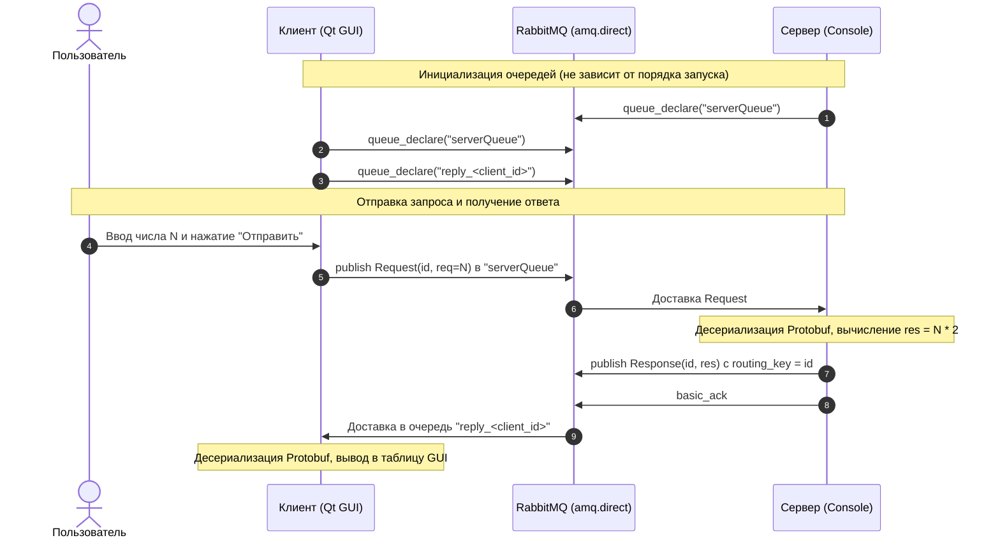

# RabbitMQ Qt Client-Server

Репозиторий практического задания «Работа с брокером сообщений на C++».

Проект реализует клиент-серверное взаимодействие через брокер сообщений **RabbitMQ** с использованием библиотеки **librabbitmq-c**, сериализации сообщений по протоколу **Google Protocol Buffers** и графического интерфейса на **Qt5 Widgets**.

---

## 1. Схема взаимодействия

Взаимодействие построено по шаблону **RPC (Remote Procedure Call)** поверх RabbitMQ:



---

## 2. Ответы на вопросы к заданию

### 2.1. Какой тип exchange был выбран и почему?
Использован стандартный обменник типа **`direct`** (`amq.direct`).

**Обоснование:**
- В задаче требуется точечная доставка сообщений: запросы отправляются в конкретную очередь сервера (`serverQueue`), а ответы должны возвращаться строго конкретному клиенту по его идентификатору (`client_id`).
- Обменник типа `direct` маршрутизирует сообщение в очередь, если ключ маршрутизации (`routing key`) сообщения точно совпадает с ключом привязки (`binding key`) очереди.
- Другие типы не подходят для этой задачи:
  - `fanout` рассылает сообщение во все привязанные очереди (ответ получили бы все клиенты, а не только запросивший);
  - `topic` использует маски (wildcards), что избыточно для точного сопоставления по идентификатору.

---

### 2.2. Каким образом обеспечивается поддержка нескольких клиентов?
1. При запуске каждый клиент генерирует глобально уникальный идентификатор `client_id` на базе UUID (например, `client_d3f4a1...`).
2. Клиент создает персональную временную очередь ответов (`reply_<client_id>`) с флагами `exclusive=1` и `auto_delete=1`, после чего привязывает её к `amq.direct` с ключом маршрутизации `routing_key = client_id`.
3. При отправке запроса клиент упаковывает свой `client_id` и введенное число `req` в Protobuf-сообщение `Request`.
4. Сервер считывает `id` из `Request`, вычисляет удвоенное значение `res = req * 2` и публикует `Response` в обменник `amq.direct` с ключом маршрутизации, равным `id` клиента.
5. Брокер направляет ответ строго в персональную очередь запросившего клиента. Ответы изолированы и не попадают другим клиентам.

---

### 2.3. Порядок создания exchange/queue и независимость порядка запуска
Программы не зависят от порядка запуска: сервер можно запустить как до, так и после клиентов.

**Обеспечение независимости:**
1. **Идемпотентная декларация очередей**:
   - При старте **и сервер, и клиент** вызывают `amqp_queue_declare` для очереди `serverQueue` с параметром `durable=1`. Если очереди ещё нет, первый запустившийся компонент создаёт её. Если она уже есть, повторный вызов не приводит к ошибке.
2. **Гарантия сохранности сообщений**:
   - Если клиент запускается первым, он объявляет `serverQueue` и публикует туда запросы. Сообщения сохраняются в очереди брокера до тех пор, пока сервер не запустится и не начнет их обработку.
   - Если сервер запускается первым, он объявляет `serverQueue` и начинает ожидать входящие сообщения.

---

## 3. Структура проекта

```text
├── CMakeLists.txt              # Корневой CMake-файл проекта
├── configs/
│   ├── server.ini              # Конфигурация сервера
│   └── client.ini              # Конфигурация клиента
├── src/
│   ├── protocol/
│   │   ├── Messages.proto      # Описание сообщений Request и Response
│   │   └── CMakeLists.txt
│   ├── common/                 # Общие модули
│   │   ├── Config.h / .cpp     # Чтение и запись .ini файлов через QSettings
│   │   └── Logger.h / .cpp     # Логирование в файл и консоль с уровнями важности
│   ├── server/                 # Консольный сервер
│   │   ├── Server.h / .cpp     # Сетевое ядро AMQP (подключение, топология, чтение)
│   │   ├── Worker.h / .cpp     # Обработка Protobuf и вычисление удвоенного числа
│   │   └── main.cpp
│   └── client/                 # GUI-клиент на Qt5
│       ├── ClientWorker.h/.cpp # Фоновый поток QThread для работы с RabbitMQ
│       ├── MainWindow.h / .cpp # Главное окно с таблицей и вводом числа
│       ├── SettingsDialog.h/.cpp # Диалог редактирования настроек (.ini)
│       └── main.cpp
└── test/                       # Модульные тесты на Google Test (32 теста)
```

---

## 4. Конфигурационные файлы (.ini)

Параметры брокера и логирования задаются в файлах `configs/server.ini` и `configs/client.ini`:

```ini
[Broker]
host=localhost
port=5672
vhost=rabbitmq_qt
username=rabbitmq_qt_user
password=rabbitmqqt
exchange=amq.direct
request_queue=serverQueue

[Logging]
log_path=server.log
log_level=INFO
```

В клиенте доступен графический интерфейс для редактирования этих параметров (кнопка «Настройки...» в окне приложения).

---

## 5. Сборка и запуск

### 5.1. Требования
- C++17 компилятор (GCC / Clang)
- CMake 3.15+
- Qt 5 (Core, Widgets, Network, Gui)
- librabbitmq (librabbitmq-dev)
- Protocol Buffers (protobuf-compiler, libprotobuf-dev)
- Google Test (libgtest-dev)
- RabbitMQ Server

### 5.2. Сборка проекта
```bash
mkdir -p build && cd build
cmake ..
cmake --build . -j$(nproc)
```

### 5.3. Запуск тестов
```bash
ctest --test-dir build --output-on-failure
```

### 5.4. Запуск приложений
1. Запуск сервера:
```bash
./build/src/server/rabbitmq_server
```

2. Запуск одного или нескольких клиентов:
```bash
./build/src/client/rabbitmq_client
```
